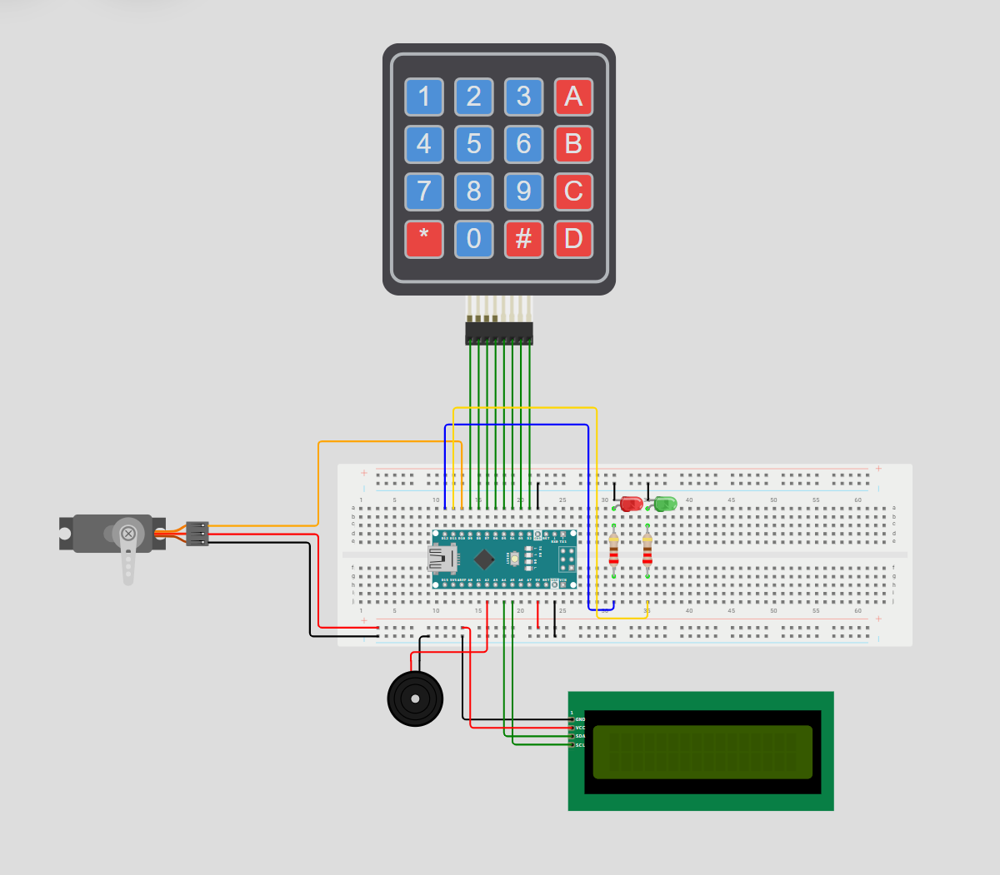

# Arduino Sentinel
A mini lock system that can be used on doors, gates, etc. using pin verification (keypad) with an I2C LCD to display information.

---

## 🚀 How It Works

The I2C LCD prompts for a PIN, in which the user types in a 4-digit PIN in the keypad. The Arduino then checks it against the verified pin. If the pin entered is correct, the Servo will turn to the unlocked position for a short period of time. If the pin entered is incorrect, the Servo will stay in the locked position, and that incorrect try will be logged. If a user reaches or exceeds the maximum number of tries available, the system will undergo a lockdown. The user must wait until the lockdown finishes. The length of the lockdown entirely depends on the amount of lockdowns in the past. 

### Hardware
- **Development Board:** Arduino Nano
- **Main Component(s):** 4x4 Membrane Switch (Keypad) + I2C LCD
- **Software:** Arduino IDE

### Cool Features
- Lockdown/anti-breach system
- Ability to clear using "*" on the keypad
- Lockdown time escalation

---

## 📊 Circuit Layouts

### Wiring Diagram

Below is the wiring diagram for the project:

**Note: This wiring diagram was made in Wokwi. Since Wokwi doesn't have a Power MB V2, the wiring diagram is an approximation of the physical build but retains the correct wiring and functionality.**

### Schematic

Below is the schematic:

*Schematic coming soon*

## 🔗 Wokwi Simulation
Try the interactive simulation of the project here:

[Open in Wokwi](https://wokwi.com/projects/480190708201797633)

---
## 🖼️ Project Photo

See the project (may have some issues viewing it on desktop):

[Click here](Arduino_Sentinel_Image.png)

## 🎥 Video Demonstration

Watch the project in action + an explanation of the build:

[▶ Watch the Video](YOUTUBE_LINK_NOT_READY)

---

## 📁 Repository Contents

- `Arduino_Sentinel.ino` — Arduino source code
- `README.md` — Project documentation
- `LICENSE` — Apache License 2.0
- `Arduino_Sentinel_Image.png` — Project photo
- `Arduino_Sentinel.png` — Wiring Diagram 
- `Schematic.png` — Coming Soon!

---

## 🛠️ Components Used

- Arduino Nano Board
- Passive Buzzer
- LEDs
- Resistors
- I2C LCD
- 4x4 Membrane Switch (Keypad)
- Servo
- Power MB V2 + 9V Battery
- Jumper wires

---

## 💡 What I Learned

I learned to use the 4x4 Membrane Switch (keypad) and learned to incorporate it into security systems.

---

## 📜 License

This project is licensed under the Apache License 2.0.
